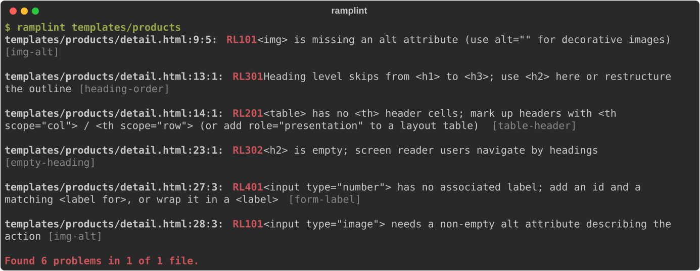

<h1 align="center">ramplint</h1>

<p align="center">
  <strong>Accessibility linter for Django and Jinja2 templates.</strong><br>
  Catch WCAG problems in your <code>.html</code> templates before they reach production.
</p>

<p align="center">
  <a href="https://github.com/iLLcruS/ramplint/actions/workflows/ci.yml"></a>
  <a href="https://pypi.org/project/ramplint/"></a>
  
  <a href="LICENSE"></a>
  <a href="https://ko-fi.com/innerexcept"></a>
</p>

---

Generic HTML linters choke on ``, `{{ variables }}` and ``,
and browser-based checkers only see the pages you remember to open.
**ramplint** reads your templates directly, understands the template syntax,
and reports problems with the exact line and column in the template source:

<p align="center">
  
</p>

## Try it in 30 seconds

The repository ships with a small demo shop in [`examples/`](examples/): a
deliberately inaccessible set of Django templates that triggers every rule,
plus a file full of tricky-but-valid template patterns that must stay silent.

```bash
git clone https://github.com/iLLcruS/ramplint.git
cd ramplint
pip install .
ramplint examples/
```

```console
examples/templates/base.html:3:1: RL601 <html> is missing a lang attribute; add e.g. lang="en" or lang="{{ LANGUAGE_CODE }}" [html-lang]
examples/templates/base.html:11:5: RL502 <a> link has no accessible name; add text, an aria-label, or alt text on the image inside it [link-name]
examples/templates/base.html:11:45: RL101  is missing an alt attribute (use alt="" for decorative images) [img-alt]
examples/templates/accounts/login.html:9:3: RL401 <input type="text"> has no associated label; add an id and a matching <label for>, or wrap it in a <label> (a placeholder is not a label) [form-label]
...
examples/templates/products/detail.html:28:3: RL101 <input type="image"> needs a non-empty alt attribute describing the action [img-alt]

Found 28 problems in 6 of 8 files.
```

See [`examples/README.md`](examples/README.md) for what each demo template contains.

## Highlights

- **Template-aware.** Django and Jinja2 tags, variables and comments are understood, not stripped blindly.
- **Low noise.** If something is only known at render time (``, `{{ widget.attrs }}`, ``), ramplint assumes the best and stays quiet.
- **Zero dependencies.** Pure Python standard library (plus `tomli` on Python < 3.11).
- **Made for CI.** Exit codes, JSON output, GitHub Actions annotations and a pre-commit hook.
- **Fast.** No browser and no rendering. A whole project is checked in well under a second.

## Installation

```bash
pip install ramplint
```

## Usage

```bash
ramplint                        # lint every template under the current directory
ramplint templates/ shop/templates/base.html
ramplint --select RL1,RL5       # only image and control rules
ramplint --ignore heading-order # rules can be referenced by code or name
ramplint --format json          # machine-readable output
ramplint --list-rules
```

By default ramplint looks at `.html`, `.htm`, `.jinja`, `.jinja2`, `.j2` and
`.djhtml` files and skips folders such as `node_modules`, `.venv`, `build` and `dist`.
Files passed explicitly are always checked, whatever their extension.

| Exit code | Meaning                      |
|-----------|------------------------------|
| `0`       | No problems found            |
| `1`       | Problems found               |
| `2`       | Usage or configuration error |

## Rules

| Code    | Name            | What it checks                                                                           | WCAG             |
|---------|-----------------|------------------------------------------------------------------------------------------|------------------|
| `RL101` | `img-alt`       | `` has an `alt` attribute; `<input type="image">` and `<area>` have non-empty `alt` | 1.1.1 (A)        |
| `RL102` | `iframe-title`  | `<iframe>` has a `title` describing its content                                          | 4.1.2 (A)        |
| `RL201` | `table-header`  | Data tables use real `<th>` header cells                                                 | 1.3.1 (A)        |
| `RL301` | `heading-order` | Heading levels do not skip (`<h2>` → `<h4>`)                                             | 1.3.1 (A)        |
| `RL302` | `empty-heading` | Headings are not empty                                                                   | 2.4.6 (AA)       |
| `RL303` | `duplicate-id`  | `id` values are unique (same id in `` / `` branches is allowed)        | 1.3.1 (A)        |
| `RL401` | `form-label`    | `<input>`, `<select>` and `<textarea>` have an associated `<label>`                      | 1.3.1, 4.1.2 (A) |
| `RL501` | `button-name`   | Buttons (including icon-only buttons) have an accessible name                            | 4.1.2 (A)        |
| `RL502` | `link-name`     | Links have an accessible name                                                            | 2.4.4, 4.1.2 (A) |
| `RL601` | `html-lang`     | `<html>` declares the page language                                                      | 3.1.1 (A)        |

<details>
<summary><strong>Examples for every rule</strong></summary>

#### RL101 `img-alt`

```django
{# ✗ #} 
{# ✓ #} 
{# ✓ #}    {# decorative #}
{# ✓ #} 
```

#### RL102 `iframe-title`

```django
{# ✗ #} <iframe src="https://www.youtube.com/embed/{{ video.id }}"></iframe>
{# ✓ #} <iframe src="https://www.youtube.com/embed/{{ video.id }}" title="{{ video.title }}"></iframe>
```

Frames hidden with `aria-hidden="true"` are skipped.

#### RL201 `table-header`

```django
{# ✗ #} <table><tr><td>Name</td><td>Price</td></tr>…</table>
{# ✓ #} <table><tr><th scope="col">Name</th><th scope="col">Price</th></tr>…</table>
{# ✓ #} <table role="presentation">…</table>              {# layout table #}
```

`role="columnheader"` on a `<td>` is not accepted. Use a real `<th>`.
Tables whose rows come from ``, `` or `{{ form.as_table }}`
are skipped because their content is not visible in the template.

#### RL301 `heading-order`

```django
{# ✗ #} <h2>Orders</h2> <h4>Recent</h4>
{# ✓ #} <h2>Orders</h2> <h3>Recent</h3>
```

The first heading in a file sets the baseline. A child template that starts at
`<h2>` (because `base.html` owns the `<h1>`) is fine.

#### RL302 `empty-heading`

```django
{# ✗ #} <h2><i class="icon-star"></i></h2>
{# ✓ #} <h2></h2>
```

#### RL303 `duplicate-id`

```django
{# ✗ #} <p id="help">…</p> … <p id="help">…</p>
{# ✓ #} <p id="greeting">…</p><p id="greeting">…</p>
```

ramplint knows which `` / `` / `` (and `` /
``) branch an element is in, so the same id in mutually exclusive
branches is not reported. Ids built from variables are skipped.

#### RL401 `form-label`

```django
{# ✗ #} <input type="email" name="email" placeholder="Email">
{# ✓ #} <label for="email">Email</label> <input type="email" id="email" name="email">
{# ✓ #} <label>Email <input type="email" name="email"></label>
{# ✓ #} <input type="search" name="q" aria-label="Search">
```

Hidden, submit, reset, button and image inputs are not checked. Neither are
widgets whose attributes are rendered dynamically (`<input {{ widget.attrs }}>`).

#### RL501 `button-name`

```django
{# ✗ #} <button><i class="fa fa-trash"></i></button>
{# ✓ #} <button aria-label=""><i class="fa fa-trash" aria-hidden="true"></i></button>
{# ✓ #} <button><span class="visually-hidden">Delete</span><i class="fa fa-trash"></i></button>
```

#### RL502 `link-name`

```django
{# ✗ #} <a href=""><svg>…</svg></a>
{# ✓ #} <a href=""><svg><title>Cart</title>…</svg></a>
{# ✓ #} <a href="/"></a>
```

#### RL601 `html-lang`

```django
{# ✗ #} <html>
{# ✓ #} <html lang="{{ LANGUAGE_CODE }}">
```

</details>

## How templates are handled

Before parsing, every template token is replaced by a placeholder of the same
length, so positions in the report always match your source:

| Template code                                                | Treated as                      |
|--------------------------------------------------------------|---------------------------------|
| `{{ variable }}`, ``, ``, `` | Text that exists at runtime     |
| ``, ``, custom tags                  | Unknown markup (rules back off) |
| ``, ``, ``, ...                   | Nothing (control flow)          |
| `{# ... #}`, `...`              | Nothing                         |

Both branches of an `` are checked, so a problem in either one is reported.

## Suppressing problems

```django
 {# ramplint: ignore RL101 #}

{# ramplint: ignore img-alt, link-name #}
<a href="/"></a>

{# ramplint: ignore-file #}
```

`ignore` applies to its own line and the next one. With no codes it silences
every rule. HTML comments work too: `<!-- ramplint: ignore RL201 -->`.

## Configuration

Add a `[tool.ramplint]` section to `pyproject.toml`. Command-line options take
precedence over it.

```toml
[tool.ramplint]
select = ["RL"]                          # default: all rules
ignore = ["RL301"]
exclude = ["*/admin/*", "templates/vendor/*"]
extensions = [".html", ".txt"]
```

## pre-commit

```yaml
# .pre-commit-config.yaml
repos:
  - repo: https://github.com/iLLcruS/ramplint
    rev: v0.1.0
    hooks:
      - id: ramplint
```

## GitHub Actions

When `GITHUB_ACTIONS=true`, ramplint switches to the `github` format and
problems appear as annotations right in the pull request diff.

```yaml
- run: pip install ramplint
- run: ramplint templates/
```

## Python API

```python
from ramplint import lint_source, select_rules

for problem in lint_source('', rules=select_rules(["RL1"])):
    print(problem.line, problem.col, problem.code, problem.message)
```

## Limitations

ramplint is a static checker. It catches structural problems early and cheaply,
but it cannot judge colour contrast or focus order, or tell whether an `alt`
text is actually meaningful. Use it together with manual testing and a runtime
tool such as axe.

## Roadmap

- [ ] More rules: `<iframe title>`, duplicate `id`s, `autocomplete` on personal-data inputs
- [ ] `aria-*` attribute and role validation
- [ ] `--fix` for safe autofixes (e.g. `scope="col"` on header rows)
- [ ] SARIF output for GitHub code scanning
- [ ] Follow `` / `` to check heading order across templates

## Contributing

Bug reports, especially about false positives, are very welcome.
See [CONTRIBUTING.md](CONTRIBUTING.md).

## Feedback and support

Questions, ideas, or using ramplint in your project? Open an
[issue](https://github.com/iLLcruS/ramplint/issues) or email me at
[rostovskii.1020@gmail.com](mailto:rostovskii.1020@gmail.com).

ramplint is free and built in my spare time. If it saved you time, you can
buy me a coffee:

<a href="https://ko-fi.com/innerexcept"></a>

## License

[MIT](LICENSE) © Vladyslav Rostovskyi
